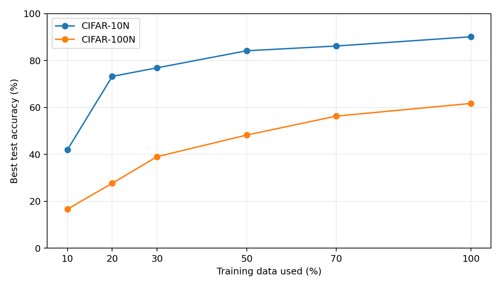

# Learning with Noisy Labels: Data Efficiency Study

Machine Learning course project (COSC 522), University of Tennessee, Knoxville.

## Overview

Image classification datasets can contain incorrect labels. In this group project, we investigated whether the relative performance of methods for learning with noisy labels changes as the available training set gets smaller.

The team compared five approaches (ProMix, PLS, CAL, ELR, and T-Revision) on CIFAR-10N and CIFAR-100N, using 10%, 20%, 30%, 50%, 70%, and 100% of the training data. The wider comparison was collaborative; **my assigned method was CAL (Calibrated Loss)**.

## My contribution: CAL

I adapted the CAL experiment configurations for different training-data fractions, ran experiments on CIFAR-10N and CIFAR-100N, recorded the results, and contributed these findings to the team comparison.

The experimental scripts in `experiments/` were adapted from the [CAL implementation by UCSC-REAL](https://github.com/UCSC-REAL/CAL); **I did not develop the CAL algorithm or the original training framework**.

## CAL results

Reported best test accuracy for the noisy-label experiments:

| Training data | CIFAR-10N | CIFAR-100N |
| ---: | ---: | ---: |
| 10% | 41.90% | 16.60% |
| 20% | 73.25% | 27.65% |
| 30% | 76.90% | 39.00% |
| 50% | 84.18% | 48.22% |
| 70% | 86.21% | 56.31% |
| 100% | 90.15% | 61.71% |

The values above come from the original course results spreadsheet, not newly executed experiments. The CSV in `results/` also includes the recorded clean-label comparisons, and the original spreadsheet is retained for reference.

## Repository contents

- `experiments/` — saved CIFAR-10 and CIFAR-100 CAL experiment scripts, adapted from upstream code
- `analysis/` — script for inspecting compatible training logs
- `results/` — original results workbook, derived CSV, and accuracy plot

## Reproducibility and limitations

This is an **archive of the CAL portion of a group course project**, not a standalone runnable implementation. The experiment scripts import `ExptPeerRegC10CAL` and `ExptPeerRegC100CAL` from modules in the original [UCSC-REAL/CAL](https://github.com/UCSC-REAL/CAL) repository, which are not bundled here.

The saved script snapshots also contain configuration settings such as `with_noise = False` and `lossfunc = "crossentropy"`. They therefore do not by themselves reproduce the noisy-label results above. The exact configurations used for every reported run, original log files, and software environment were not retained in this archive.

The saved CAL scripts specify `resnet_cifar34`, while the group presentation summarizes a ResNet-18 setup. This discrepancy has not been reconciled; the scripts are preserved as found rather than silently modified.

The dataset and upstream code should be obtained from the original sources before attempting replication. No claims of a verified end-to-end reproduction are made for this archive.

## License and Attribution

The CAL implementation is based on the original
[UCSC-REAL/CAL](https://github.com/UCSC-REAL/CAL) repository,
released under the MIT License.

The original copyright and license notice are
preserved in `LICENSE-UPSTREAM`.

## References and credits

- [CIFAR-N datasets and benchmark](https://www.yliuu.com/web-cifarN/index.html); see also [noisylabels.com](http://noisylabels.com/)
- [UCSC-REAL/CAL source code](https://github.com/UCSC-REAL/CAL) — original implementation, distributed under the MIT license. The upstream copyright and permission notice is included as `LICENSE-UPSTREAM`.
- Zhu, Z., Liu, T., and Liu, Y. (2021). *A Second-Order Approach to Learning with Instance-Dependent Label Noise*. CVPR. [Paper](https://arxiv.org/abs/2012.11854).
- Wei, J., Zhu, Z., Cheng, H., Liu, T., Niu, G., and Liu, Y. (2022). *Learning with Noisy Labels Revisited: A Study Using Real-World Human Annotations*. ICLR. [Paper](https://openreview.net/forum?id=TBWA6PLJZQm).

Group project collaborators: Cem Ege Ergun, Todd Casey Van Meter, Khan A. Yawar, and Adam Winschel. The five-algorithm comparison and presentation were team work. 
This repository focuses on my CAL experiments only.